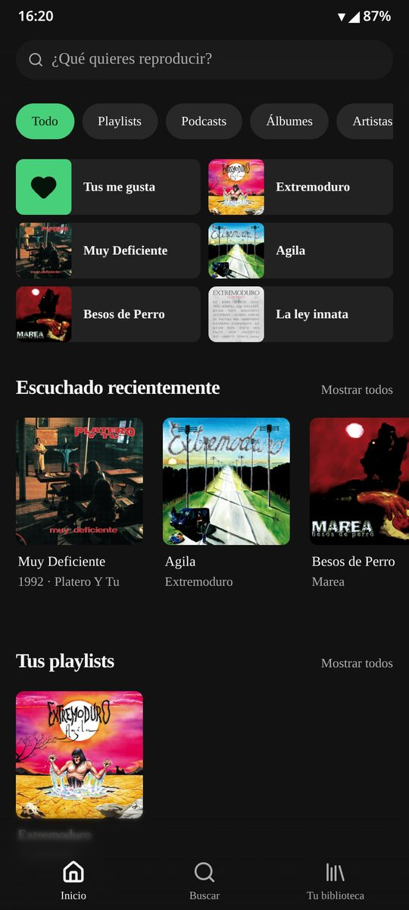
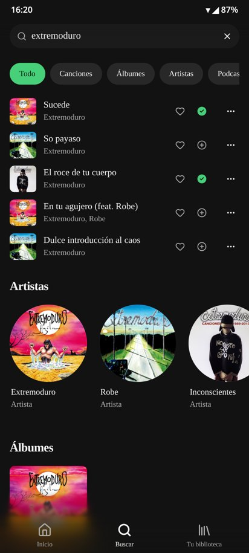
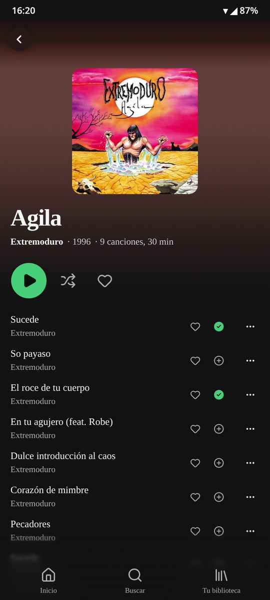
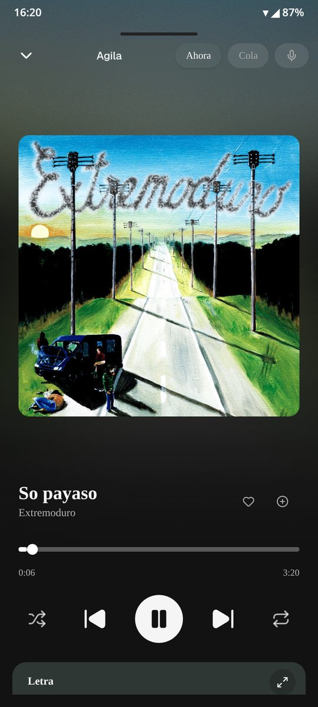
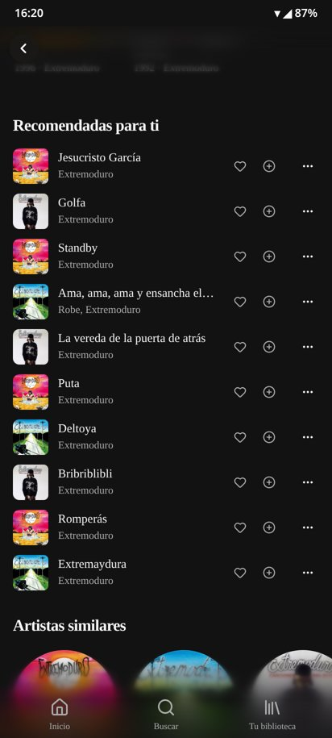
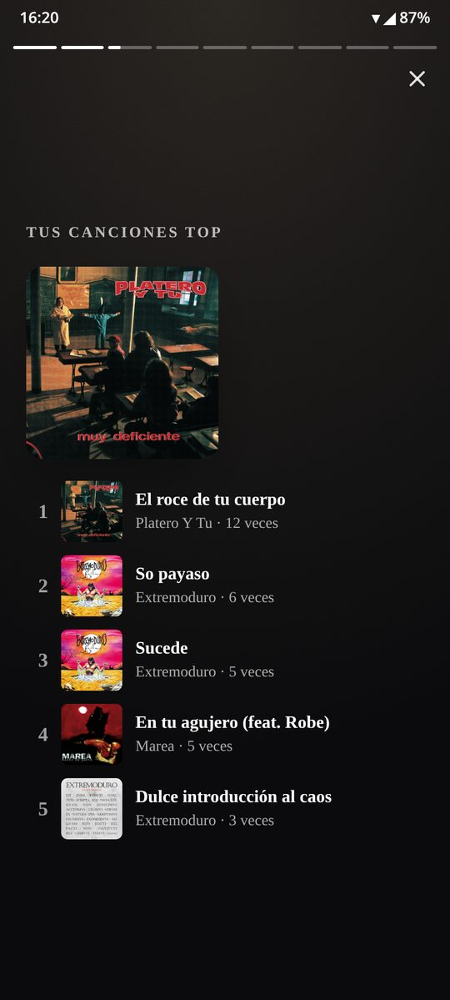
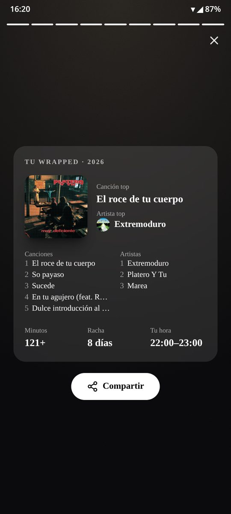
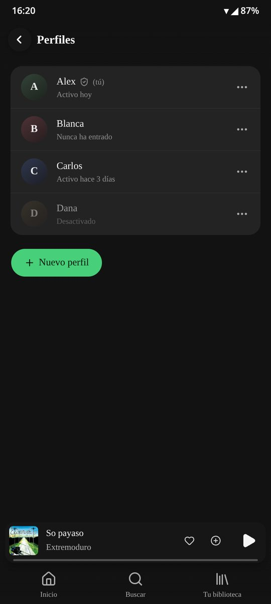
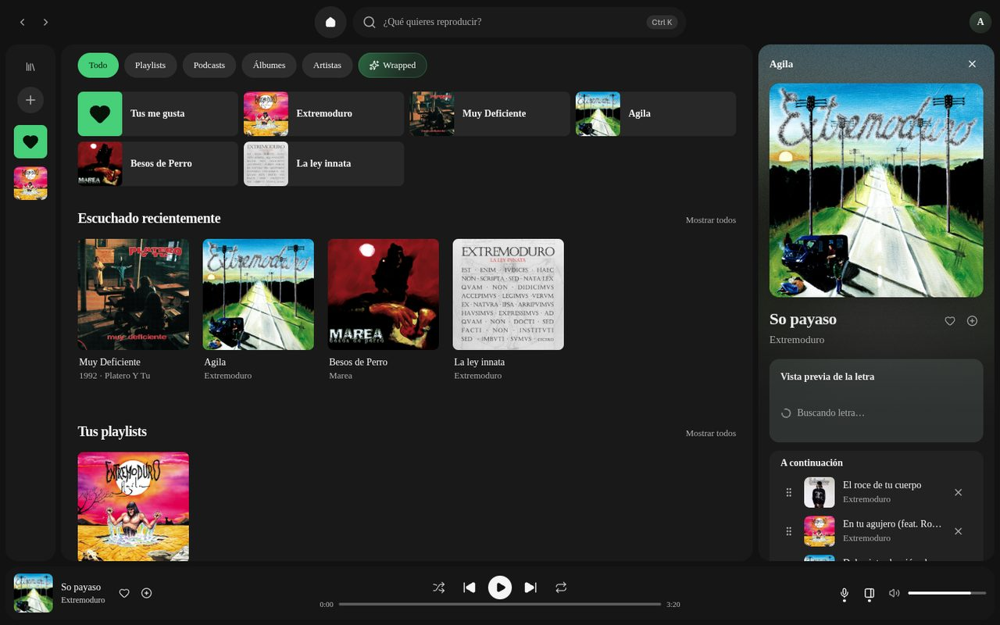

# Decibel

**Decibel** is a self-hosted, Spotify-style music player. It uses the YouTube Music catalogue (through
[ytmusicapi](https://ytmusicapi.readthedocs.io/)) with audio streamed via [yt-dlp](https://github.com/yt-dlp/yt-dlp),
can also play your own library from Navidrome/Subsonic, follows podcasts over RSS, and has per-person profiles.
It runs as a web app/PWA and as an Android app built with Tauri.

> **Language:** the app's user interface is currently in **Spanish**. Code, comments in new code and documentation
> are in English. Translations are welcome (see [CONTRIBUTING.md](CONTRIBUTING.md)).

> **Disclaimer:** unofficial, non-commercial project, not affiliated with YouTube or Google. For personal use only and
> in accordance with YouTube's Terms of Service. Read [DISCLAIMER.md](DISCLAIMER.md).

<p>
  
  
  
  
</p>
<p>
  
  
  
  
</p>


*Screenshots use demo data and generic profile names.*

## Contents

- [Features](#features)
- [Architecture](#architecture)
- [Requirements](#requirements)
- [Quick start (local development)](#quick-start-local-development)
- [Self-hosting in production](#self-hosting-in-production)
- [Building the Android APK](#building-the-android-apk)
- [Environment variables](#environment-variables)
- [Development](#development)
- [Contributing](#contributing) · [Security](#security) · [Disclaimer](#disclaimer) · [License](#license)

## Features

- **YouTube Music catalogue**: search with suggestions (songs, albums, artists), album and artist pages, artist
  recommendations, similar artists and automatic radio when the queue ends. No Google account required.
- **Streaming with yt-dlp**: the server only resolves a short-lived audio URL; the device streams it directly.
  Audio from YouTube is never stored, and offline downloads are blocked for that source.
- **Navidrome / Subsonic** as an alternative source, with offline downloads (Subsonic only).
- **Podcasts**: search, RSS feeds, follow shows, "continue listening" and top charts per country (Apple's public charts).
- **Profiles**: login with long-lived sessions and an admin panel. Each profile has its own likes, history,
  playlists (private, shared with viewer/editor roles, or collaborative), settings and a yearly **Wrapped**.
- **Player**: synced lyrics from [LRCLIB](https://lrclib.net), editable queue, shuffle/repeat, crossfade and
  gapless playback, Media Session controls, clickable artist credits (each featured artist links to its page).
- **Themes**, including a dynamic one that follows the album artwork.
- **Platforms**: web, installable PWA and an Android app (Tauri v2) with a media notification and background
  playback. Desktop and iOS builds through Tauri are possible but untested.

## Architecture

```
 Browser / PWA / Android (Tauri WebView)
        │  static Next.js export (React 19, zustand, Tailwind)
        ▼
 Node.js server (server/index.mjs) ── SQLite (node:sqlite): profiles, sessions, likes, history, playlists
        │
        ├── ytmusicapi (Python, server/ytmusic.py): catalogue search, albums, artists, radio
        ├── yt-dlp: resolves a signed audio URL ──► the device streams the audio directly from YouTube
        └── podcasts: RSS, charts, safe proxy for artwork and audio (public addresses only)
```

- **Frontend**: Next.js 15 with `output: "export"` (static files, routes use `?id=` query strings). Music sources
  implement the `MusicProvider` interface in `src/lib/types.ts` (`ytdlp`, `subsonic`, `mock`, plus podcasts).
- **Server**: a single Node.js process serves the static web app and the `/api/*` endpoints. No external database.
- **Android**: the same web build packaged with Tauri v2, plus a small native layer
  ([src-tauri/android-overlay/](src-tauri/android-overlay/README.md)) for the media session, notification and
  foreground playback service.

```
src/app/*                  pages
src/components/*           UI (player, layout, podcasts, wrapped…)
src/lib/providers/*        music sources: ytdlp, subsonic, mock, podcasts
src/stores/*               client state (zustand): player, session, profile, history
server/index.mjs           HTTP server: static web app + API
server/ytdlp.mjs           audio resolution and library
server/ytmusic.{mjs,py}    YouTube Music catalogue bridge
server/accounts.mjs        profiles, passwords (scrypt) and sessions
server/podcast*.mjs        RSS, charts and safe artwork/audio proxy
src-tauri/                 Tauri v2 project and Android native code (android-overlay/)
deploy/systemd/            hardened systemd unit, installer and health check
```

More details: [docs/self-hosting.md](docs/self-hosting.md) and [docs/profiles.md](docs/profiles.md) (profiles, sessions and API).

## Requirements

- **Node.js 22.9+** (uses the built-in `node:sqlite`).
- **Python 3.10+** with `venv` (for ytmusicapi and yt-dlp; installed locally into `.tools/`).
- Linux, macOS or WSL for development. Production: Linux with systemd (x86_64 or ARM64).
- For the Android app: Rust, Android SDK and NDK (see [Building the Android APK](#building-the-android-apk)).

## Quick start (local development)

```bash
git clone https://github.com/<you>/Decibel.git && cd Decibel
npm install
npm run music:setup        # downloads yt-dlp (SHA-256 verified) and installs ytmusicapi into .tools/
cp .env.example .env.local # adjust if needed
npm run dev                # Next.js on :3000 + API on :3001
```

On the **first start** (empty database) a single **admin** profile is created from `DECIBEL_ADMIN_USER` /
`DECIBEL_ADMIN_PASSWORD`. If no password is set, a random one is generated and printed **once** in the console.
Log in and create the other profiles under **Perfiles** (`/admin`).

Want to try the UI without any backend? Set `NEXT_PUBLIC_DATA_SOURCE=mock`.

## Self-hosting in production

Full guide: **[docs/self-hosting.md](docs/self-hosting.md)**. In short:

1. **Build and run** in a single process:
   ```bash
   npm ci && npm run music:setup && npm run build
   MUSIC_HOST=127.0.0.1 MUSIC_PORT=3000 npm run serve
   ```
2. **systemd**: [deploy/systemd/decibel.service](deploy/systemd/decibel.service) runs Decibel as an unprivileged
   `decibel` user with `ProtectSystem=strict` and data in `/var/lib/decibel`. `npm run package:server` builds a
   self-contained package and [deploy/systemd/install.sh](deploy/systemd/install.sh) installs it, backing up the
   data first and rolling back if the health check fails.
3. **HTTPS in front**: a reverse proxy (Caddy, nginx, Traefik) or a **Cloudflare Tunnel** pointing to
   `http://127.0.0.1:3000`, e.g. `decibel.example.com`. Never expose the Node port directly.
4. **`DECIBEL_TRUST_PROXY=loopback`** when the proxy/tunnel runs on the same machine (or the proxy's IP). Without it,
   HTTPS logins are rejected by the origin check, the session cookie is not `Secure` and login rate limiting
   sees a single IP.
5. **First admin**: set `DECIBEL_ADMIN_USER`/`DECIBEL_ADMIN_PASSWORD` for the first start, or read the one-time
   random password from the log (`journalctl -u decibel`). Use long passwords: the login page is public.
6. **Backups**: back up `DECIBEL_DB` (SQLite, use the online backup API or stop the service) and `MUSIC_DATA_DIR`.

## Building the Android APK

The APK is the web build packaged with Tauri v2 plus the native overlay. The default application id is
`app.decibel.music`; if you distribute your own build, change `identifier` in `src-tauri/tauri.conf.json`
(and the `package` of the overlay `.kt` files).

1. Install Rust, the **Android SDK** (platform + build-tools) and the **NDK**, and set `ANDROID_HOME` and
   `NDK_HOME` ([Tauri prerequisites](https://v2.tauri.app/start/prerequisites/)). Add the target:
   `rustup target add aarch64-linux-android`.
2. Build the web app pointing at **your** server (these values are baked in at build time):
   ```bash
   NEXT_PUBLIC_DATA_SOURCE=ytdlp \
   NEXT_PUBLIC_DECIBEL_SERVER=https://decibel.example.com \
   NEXT_PUBLIC_YTDLP_URL=https://decibel.example.com \
   npm run build
   ```
3. Generate the Android project and apply the overlay (details in
   [src-tauri/android-overlay/README.md](src-tauri/android-overlay/README.md)):
   ```bash
   npm run tauri android init -- --ci
   cp -r src-tauri/icons-symmetric/android/* src-tauri/gen/android/app/src/main/res/
   J=src-tauri/gen/android/app/src/main/java/app/decibel/music
   cp src-tauri/android-overlay/{MainActivity,DecibelMedia,MediaPlaybackService}.kt $J/
   cp src-tauri/android-overlay/ic_stat_decibel.xml src-tauri/gen/android/app/src/main/res/drawable/
   python3 src-tauri/android-overlay/patch-manifest.py src-tauri/gen/android/app/src/main/AndroidManifest.xml
   npm run tauri android build -- --apk --target aarch64
   ```
4. **Sign with your own keystore**, stored outside the repository:
   ```bash
   keytool -genkeypair -v -keystore ~/keys/decibel.jks -alias decibel -keyalg RSA -keysize 4096 -validity 10000
   APK=src-tauri/gen/android/app/build/outputs/apk/universal/release/app-universal-release-unsigned.apk
   zipalign -f -p 4 "$APK" decibel-aligned.apk
   apksigner sign --ks ~/keys/decibel.jks --ks-key-alias decibel --out Decibel.apk decibel-aligned.apk
   apksigner verify --print-certs Decibel.apk
   ```
   Alternatively let Gradle sign the release build: create `src-tauri/gen/android/keystore.properties`
   (`storeFile`, `storePassword`, `keyAlias`, `keyPassword`) and a `signingConfigs` block as described in the
   [Tauri Android signing guide](https://v2.tauri.app/distribute/sign/android/). `keystore.properties`, `*.jks` and
   `*.keystore` are git-ignored: **never commit them**. Android only installs updates signed with the same key and
   the same application id, so keep the keystore and its password safe.
5. On the server, keep the Tauri origins in `YTDLP_ALLOWED_ORIGINS` (already in `.env.example`).

## Environment variables

Copy [.env.example](.env.example) to `.env.local`. `NEXT_PUBLIC_*` variables are baked in at build time; the rest
are read by the server at start-up.

| Variable | Default | Purpose |
| --- | --- | --- |
| `NEXT_PUBLIC_DATA_SOURCE` | `ytdlp` | Initial source: `ytdlp`, `mock` (demo) or `subsonic`. |
| `NEXT_PUBLIC_YTDLP_URL` | empty (same server) | Decibel server URL for the native app or a web app hosted elsewhere. |
| `NEXT_PUBLIC_DECIBEL_SERVER` | empty | Fixed profile server. The app does not offer to switch source; meant for your own APK. |
| `NEXT_PUBLIC_SUBSONIC_URL` | empty | URL pre-filled in the Navidrome/Subsonic login. |
| `MUSIC_HOST` / `MUSIC_PORT` | `0.0.0.0` / `3000` | Where the server listens. Behind a tunnel or proxy, use `127.0.0.1`. |
| `MUSIC_API_PORT` | `3001` | Standalone API port (`npm run music:server`, used by `npm run dev`). |
| `MUSIC_DATA_DIR` | `data/music` | Legacy library and metadata. |
| `DECIBEL_DB` | `data/decibel.db` | SQLite database for profiles. |
| `DECIBEL_ADMIN_USER` / `DECIBEL_ADMIN_PASSWORD` | `admin` / random | Only used on the first start, with an empty database. |
| `DECIBEL_TRUST_PROXY` | `false` | `loopback` or a list of proxy IPs whose `X-Forwarded-Proto` and `CF-Connecting-IP` headers are trusted. Required behind an HTTPS proxy/tunnel. |
| `YTDLP_ALLOWED_ORIGINS` | Tauri origins | Extra CORS origins (exact scheme, host and port), comma-separated. |
| `YTDLP_BIN`, `YTMUSIC_PYTHON`, `YTDLP_CACHE_DIR`, `PYTHON_BIN` | `.tools/…` | Alternative tool paths. |

## Development

```bash
npm test             # server and client tests (node --test)
npm run typecheck    # tsc --noEmit
npm run lint         # eslint
npm run build        # next build (static export to out/)
```

To add another music source, implement `MusicProvider` (`src/lib/types.ts`).

Keyboard shortcuts (desktop): `Space` play/pause · `Shift+→/←` next/previous · `→/←` ±5 s · `↑/↓` volume ·
`M` mute · `S` shuffle · `R` repeat · `/` or `Ctrl+K` search.

## Contributing

Contributions are welcome. Please read [CONTRIBUTING.md](CONTRIBUTING.md) first: one change per pull request,
checks passing, and **before/after screenshots for every visual change**. Everyone is expected to follow the
[Code of Conduct](CODE_OF_CONDUCT.md).

## Security

Please do not open public issues for vulnerabilities. See [SECURITY.md](SECURITY.md) for how to report them
privately and for an overview of the security model.

## Disclaimer

Decibel does not host or distribute any content and is not affiliated with YouTube, Google, Apple or Cloudflare.
Use it for personal, private purposes and comply with the terms of the services you connect. See
[DISCLAIMER.md](DISCLAIMER.md).

## License

[MIT](LICENSE) © 2026 Decibel contributors. yt-dlp, ytmusicapi and the other dependencies are distributed under
their own licenses.
